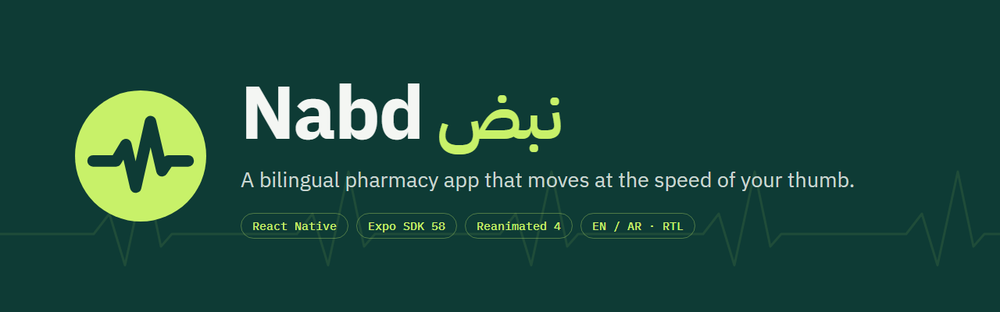
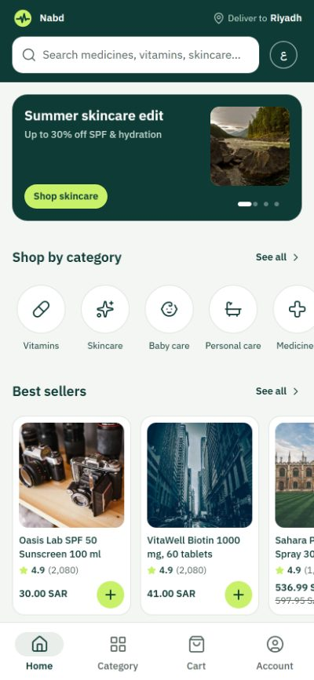
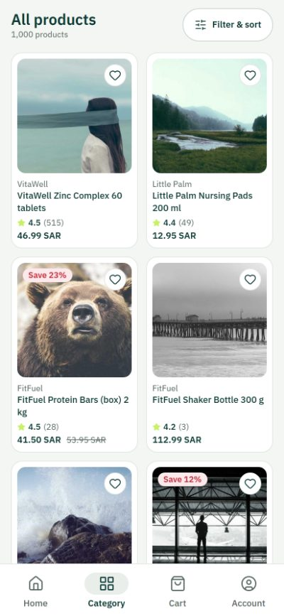
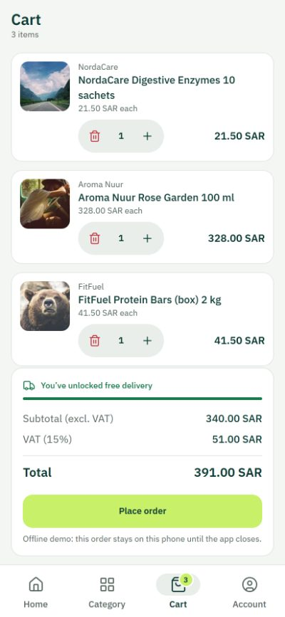
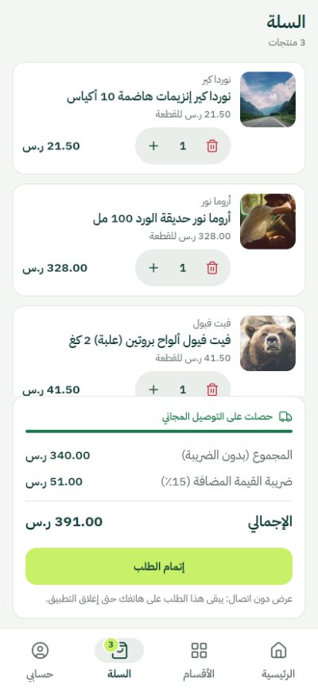
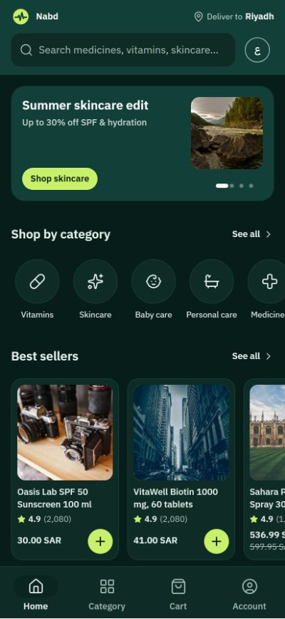
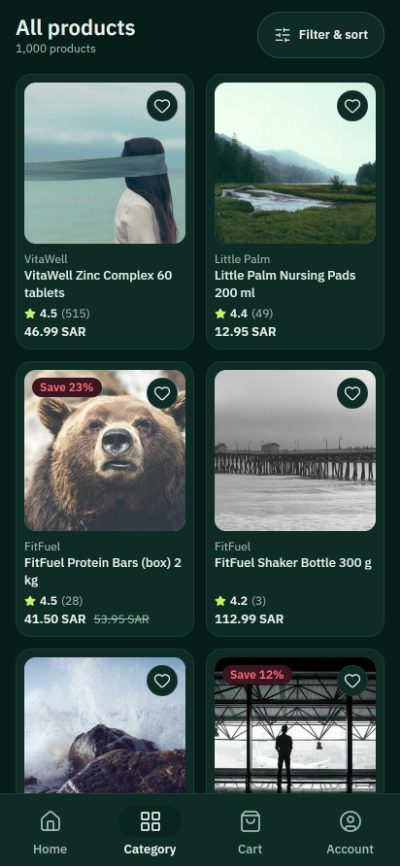
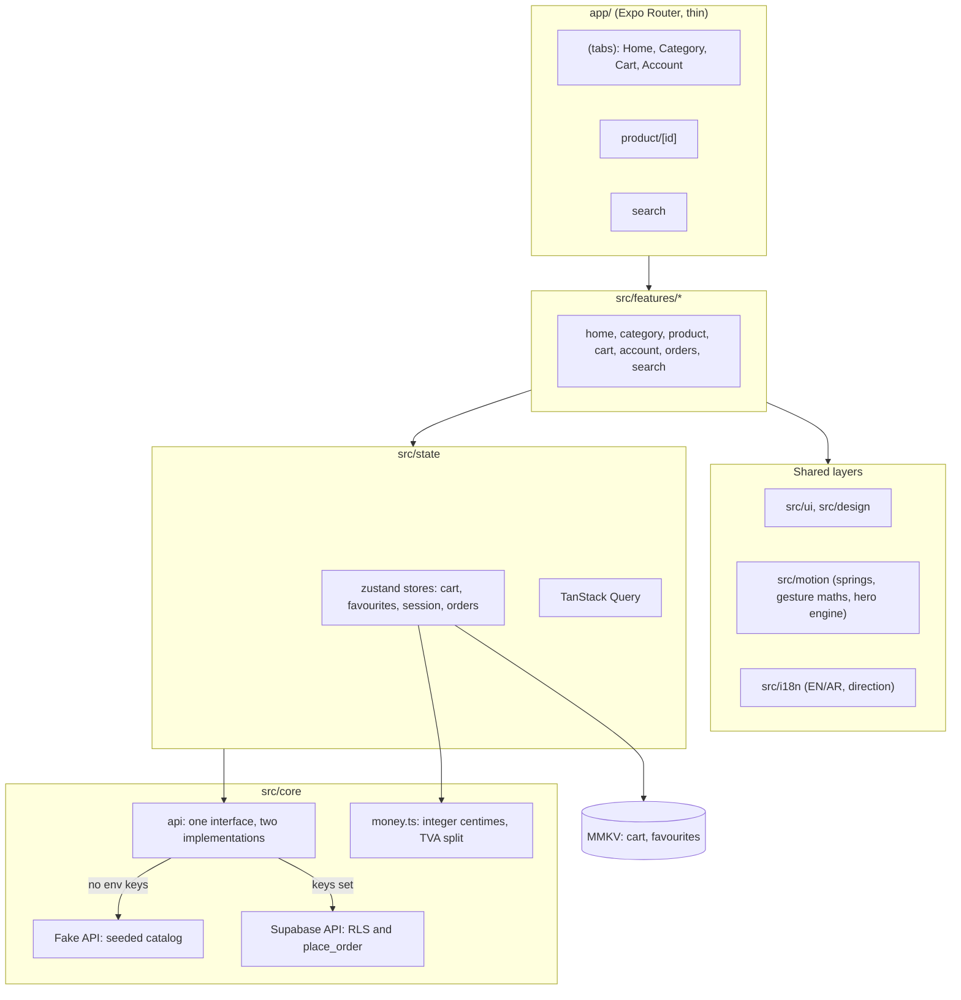

<p align="center">
  
</p>

<p align="center">
  <a href="https://github.com/ismailbentabett/nabd-pharmacy/actions/workflows/ci.yml"></a>
  <a href="LICENSE"></a>
  
  
  
  
</p>

<p align="center">
  <b>Nabd</b> is a bilingual pharmacy app for Algeria where every gesture runs on the UI thread and Arabic mirrors the whole app, swipes included.<br>
  <b>نبض</b> تطبيق صيدلية ثنائي اللغة للجزائر، تعمل فيه كل الحركات على خيط الواجهة، وينقلب التطبيق كله إلى اليمين لليسار بما في ذلك اتجاه السحب.
</p>

---

## Contents

- [Screenshots](#screenshots)
- [Motion](#motion)
- [Features](#features)
- [Quick start](#quick-start)
- [Use Supabase (optional)](#use-supabase-optional)
- [Architecture](#architecture)
- [Money](#money)
- [Testing](#testing)
- [Performance](#performance)
- [Main decisions](#main-decisions)
- [Where AI tools were used](#where-ai-tools-were-used)
- [Known limits](#known-limits)
- [Roadmap](#roadmap)
- [Contributing, security and license](#contributing-security-and-license)

## Screenshots

English (left to right) and Arabic with the layout mirrored (right to left), plus dark mode.

| | | |
|:---:|:---:|:---:|
|  |  |  |
| Home | Category, 1,000-item grid | Product |
|  |  |  |
| Cart | الرئيسية (Home, RTL) | المنتج (Product, RTL) |
|  |  |  |
| السلة (Cart, RTL) | Home, dark | Category, dark |

## Motion

Animation is the main thing this project is about. All of it runs on the UI thread with Reanimated shared values
and worklets. There is no per-frame React state, and a pattern linter fails the build if someone adds it.

- **Shared-element hero.** The tapped tile image grows into the product gallery and returns on back. Progress is one
  shared value, so a swipe can drive it and a new touch interrupts it. The spring settles in under 320 ms (checked
  by a unit test that simulates the spring, not by a device run).
- **Bottom sheet.** The filter and sort sheet tracks the finger and snaps open or closed from the release velocity.
- **Swipe to delete with undo.** Cart rows slide away, the rest of the list closes the gap, and an undo bar restores
  the line at its original position within 5 seconds. Only one row is open at a time.
- **Collapsing header.** The Home search header shrinks into a compact bar as you scroll.
- **Banner carousel.** It auto-plays, shows a page indicator and pauses while touched.
- **Cart badge bump.** Add to cart flies a copy of the product toward the tab bar and bumps the badge.
- **Favourite heart.** One pop animation, one shared state for the grid tile and the product page.
- **RTL-mirrored gestures.** Swipe, sheet, hero and carousel maths multiply by the layout direction, so Arabic
  reverses them along with the layout.
- **Reduce motion.** The system setting is read live. Springs and timings collapse and the hero becomes a short
  cross-fade, with no restart needed.

## Features

- **Home.** Collapsing search header, banner carousel, category rail, best-sellers rail.
- **Category.** Two-column virtualised grid of 1,000 products (FlashList v2). Images fade in once from a colour
  placeholder and are requested at a bucketed display size, not full size. Filter and sort in a bottom sheet.
- **Product.** Hero transition, swipeable gallery with a page indicator, add-to-cart feedback, favourite heart.
- **Cart.** Animated add and remove, swipe to delete with undo, quantity stepper, subtotal, TVA line and total in DA,
  and checkout.
- **Account.** Email one-time-code sign-in, favourites and order history. Without Supabase keys it says so and the
  rest of the app keeps working.
- **Search.** A pushed screen (`app/search.tsx`) with a 250 ms debounce, cached results, and a distinct view for idle,
  loading, empty, error with retry and results.
- **Everything else.** Skeletons for every loading state, designed empty and error states, a launch veil that hands
  off from the native splash, dark mode that follows the system, English and Arabic with IBM Plex Sans and IBM Plex
  Sans Arabic embedded natively.

<details>
<summary><b>Backend, accounts, checkout, favourites and search in detail</b></summary>

- **Optional Supabase backend.** `getSupabase()` in `src/core/supabase/client.ts` returns `null` when there are no
  keys, and the app uses the fake API. `api.kind` and `ordersApi.kind` report which one is live. Only the anon key
  ships in the app. Row Level Security is the security boundary (ADR-056).
- **Fake backend.** 1,000 products from a fixed seed, pages of 20, a random 300 to 800 ms delay, and about 1 in 20
  requests failing so the error states are visible. Release builds made for measurement turn the failures off
  (`--demo` turns them on).
- **Sign-in.** Email one-time code (`src/features/account/auth.ts`). One session store
  (`src/state/session.store.ts`) with four states: `offline`, `loading`, `signedOut`, `signedIn`.
- **Checkout and orders.** With Supabase, the client sends only product ids, quantities and a request id to the
  `place_order` function. The server prices the order in integer centimes, TVA included, and a retry with the same
  request id returns the same order instead of writing a second one (ADR-057, ADR-060). Without Supabase, orders are
  placed in memory on the device and the app says so. There are no real payments.
- **Favourites.** `src/state/favorites.store.ts` stores them in MMKV and mirrors them to `public.favorites` when
  signed in. Each tile subscribes to a per-id boolean, so toggling one heart re-renders only the hearts for that id
  (ADR-058).
- **Search.** One ranking, implemented twice: in the fake API and in the Supabase search function (ADR-059).

</details>

## Quick start

You need Node 22 or 24, a JDK, the Android SDK and an Android phone with USB debugging on. Expo Go is not supported
(ADR-001): this is a native build. A fresh clone runs with no keys, on the built-in fake backend.

```bash
git clone https://github.com/ismailbentabett/nabd-pharmacy.git nabd && cd nabd   # 1
npm ci                                                                         # 2
bash scripts/perf/android-release-build.sh                                     # 3: release APK, installed on the USB phone
```

The first native build takes several minutes (8 min 23 s on one Windows PC, ADR-040).

- **Day-to-day work:** `npm run android` builds a debug app and starts Metro with hot reload. Debug builds are slower
  and are never used for performance numbers.
- **Windows:** the native build needs a project path of 5 characters or fewer, for example
  `git clone https://github.com/ismailbentabett/nabd-pharmacy.git C:/nb`. The build script checks this and prints the
  exact command if the path is too long (ADR-040).
- **Demo build:** `bash scripts/perf/android-release-build.sh --demo` keeps the 1-in-20 fake failures on.
- **Build without a phone:** `PERF_NO_DEVICE=1 bash scripts/perf/android-release-build.sh` builds the APK and skips the install.
- **Web preview:** `npx expo start --web` shows layout only. It says nothing about motion or performance.
- **Checks:** `npm run check` runs the typecheck, the pattern linter and its self-test, and Jest.
  `npm run check:full` adds expo lint, expo-doctor and a repo hygiene check.

| Script | What it does |
|---|---|
| `npm start` | Start Metro |
| `npm run android` | Debug build and run on a device or emulator |
| `npm run android:release` | Release build and run (`expo run:android --variant release`) |
| `npm test` | Jest |
| `npm run typecheck` | `tsc --noEmit` |
| `npm run lint` | `expo lint` |
| `npm run check` / `npm run check:full` | Quality gate, quick and full |
| `npm run supabase:seed` | Regenerate `supabase/seed.sql` from the fixed seed |

## Use Supabase (optional)

<details>
<summary><b>Setup steps and exact run order</b></summary>

1. Create a Supabase project.
2. In the SQL editor (or with the CLI), run these files **in this order**:

   | Order | File | Adds |
   |---|---|---|
   | 1 | `supabase/migrations/20261120000100_schema.sql` | Tables |
   | 2 | `supabase/migrations/20261120000200_rls.sql` | Row Level Security policies |
   | 3 | `supabase/migrations/20261120000300_place_order.sql` | Server-priced `place_order` function |
   | 4 | `supabase/migrations/20261120000400_search.sql` | Search |
   | 5 | `supabase/migrations/20261120000500_order_idempotency.sql` | `place_order(lines, request_id)`, one order per request id |
   | 6 | `supabase/migrations/20261121000100_tva_19.sql` | Algeria money rules: centimes, 19% TVA |
   | 7 | `supabase/seed.sql` | 8 categories, 1,000 products, 4 banners |
   | 8 (optional) | `supabase/demo-users.sql` | 24 fictional shoppers with favourites and orders |

   `seed.sql` is generated. To rebuild it from the same fixed seed, run `npm run supabase:seed`.
   `demo-users.sql` must run after the migrations and the seed. It is safe to run again: it deletes its own demo
   users first. The users have no password, so nobody can sign in as them.

3. Create a `.env` file at the repo root with `EXPO_PUBLIC_SUPABASE_URL` and `EXPO_PUBLIC_SUPABASE_ANON_KEY` set to
   the project URL and the anon (public) key. Never put the service-role key in the app. See `SECURITY.md`.
4. Enable the email provider in Supabase Auth so one-time codes can be sent.

Expo inlines these variables at build time, so rebuild after changing them. Remove them and the app goes back to
the fake backend.

</details>

## Architecture



Rules that keep it small: `src/core` imports nothing from React Native, `src/features/*` do not import each
other, routes hold no business logic, and the only file that reads `I18nManager` is under `src/i18n`.

<details>
<summary><b>Source tree</b> (trimmed)</summary>

```
app/                     Expo Router routes
  (tabs)/                index, category, cart, account
  product/[id].tsx       Product page, host for the hero transition
  search.tsx
src/
  core/                  Framework-free and testable
    api/                 Fake API, Supabase API, orders API
    catalog/             Seeded generator and copy tables
    supabase/            Client (null without keys)
    money.ts             Integer centimes, TVA split
    rng.ts               Seeded random numbers
  state/                 Cart, favourites, session and orders stores, cart maths, query client
  motion/                Spring tokens, gesture maths, haptics, reduce-motion
    hero/                Shared-element engine (registry, maths, back gestures)
  ui/                    Tab bar, bottom sheet, badge, stepper, price block, image, skeleton, states
  design/                Palette, tokens, type scale, fonts, Text, PressableScale, brand mark
  i18n/                  Typed EN/AR dictionary, plurals, number formatting, direction
  features/
    home/                Header, carousel, rails
    category/            Grid, tile, filter and sort sheet, paging
    product/             Gallery, add-to-cart bar, fly-to-cart motion
    cart/                Swipe rows, list, summary, checkout
    account/             Sign-in, favourites list
    orders/              Order history
    search/              Search screen
supabase/                migrations/, seed.sql, demo-users.sql
tests/                   Jest and React Native Testing Library
scripts/                 check.sh, pattern linter, perf/, supabase/, brand/
docs/                    ADRs, specs, perf log, AI disclosure, README images
landing/                 Static landing page and screenshots
.claude/                 Subagents, skills and commands used to build this
```

</details>

Stack: Expo SDK 58 (React Native 0.88, New Architecture, Hermes, React Compiler), Expo Router, TypeScript strict,
Reanimated 4 with `react-native-worklets`, Gesture Handler 3 (hooks API), FlashList v2, `expo-image`, zustand,
TanStack Query, `react-native-mmkv`, `expo-haptics`, Lucide icons, and optional Supabase.

More detail: [`docs/ARCHITECTURE.md`](docs/ARCHITECTURE.md), [`docs/DESIGN.md`](docs/DESIGN.md),
[`docs/RTL_CHECKLIST.md`](docs/RTL_CHECKLIST.md).

## Money

Money is integer centimes everywhere in logic (1 DA = 100 centimes). Floats appear only when formatting. Prices
include 19% TVA, so the TVA line is the 19/119 share of the gross total, rounded half up, computed once:

```
tva = floor((38 * gross + 119) / 238)
net = gross - tva
```

Worked example, a 14,000 DA cart:

| Line | Centimes | Shown |
|---|---:|---:|
| Subtotal (excl. TVA) | 1,176,471 | 11,764.71 DA |
| TVA (19%) | 223,529 | 2,235.29 DA |
| **Total** | **1,400,000** | **14,000.00 DA** |

`gross = 1,400,000`, so `tva = floor((38 * 1,400,000 + 119) / 238) = floor(53,200,119 / 238) = 223,529`, and
`net = 1,400,000 - 223,529 = 1,176,471`. The invariant `net + tva === gross` holds for every cart. English shows
`DA`, Arabic shows `د.ج`, and both use Western digits with two decimals. The same formula runs in
`src/core/money.ts` and in the `place_order` SQL function. Full rules:
[`docs/CART_SPEC.md`](docs/CART_SPEC.md).

## Testing

```bash
npm test                  # Jest only
npm run check             # typecheck, pattern linter and its self-test, Jest
```

The suite has **839 Jest tests in 56 suites** (all passing on the last run, `npx jest --silent`). It covers:

- Cart quantities, totals and the TVA split against the vectors in `docs/fixtures/cart-vectors.json`, plus the
  store, undo and a 10,000-cart property test for `net + tva === gross`.
- Catalog determinism (same seed, same 1,000 products) and the fake API (paging, delay, failures).
- Parity between the generated `seed.sql` and the catalog.
- i18n: EN and AR key and placeholder parity, plurals, number formatting.
- Gesture and motion maths: sheet snapping, hero geometry, swipe, carousel, header, fly path, spring settle times.
- Screen and component tests for the screens, tab bar, badge, checkout, favourites and search.

CI ([`.github/workflows/ci.yml`](.github/workflows/ci.yml), Node 22) runs the typecheck, lint and Jest on every push
and pull request to `master`.

Jest runs against the fake backend only. Nothing in the suite talks to a real Supabase project, so the migrations,
RLS policies and `place_order` are not tested end to end in CI. Jest also cannot cover one swipe row closing
another, because Reanimated's mock never runs `useAnimatedReaction`; that stays on the device checklist.

## Performance

**Nothing has been measured on a phone yet.** Every cell below is copied from [`docs/PERF_LOG.md`](docs/PERF_LOG.md).
That includes the newer features (Account, Search, checkout, favourites, Supabase data). Simulators, emulators and
debug builds are never used for a figure, and no number here is an estimate.

| Field | Value |
|---|---|
| Device model | Not measured yet |
| Android version / build | Not measured yet |
| Build type | Not measured yet (planned: release APK from `scripts/perf/android-release-build.sh`) |

| Metric | Target | Result |
|---|---|---|
| Janky frames, 10 s grid fling, warm cache | under 1 % | Not measured yet |
| Janky frames, same fling, cold cache | report | Not measured yet |
| Average UI FPS (Flashlight) | at least 58 at 60 Hz | Not measured yet |
| Hero transition janky frames and duration | 0 janky, at most 350 ms | Not measured yet |
| Cold start TotalTime (median of 10) | under 2,000 ms | Not measured yet |
| Time to first product visible | report | Not measured yet |
| Memory (PSS) after scroll pass 1 to pass 2 | flat within 8 % | Not measured yet |
| Touch feedback latency | at most 100 ms | Not measured yet |
| Tile re-renders on add to cart | 0 | Not measured yet |

<details>
<summary><b>How the numbers will be measured</b></summary>

Release build, real mid-range Android phone, with `scripts/perf/cold-start.sh`, `gfxinfo-fling.sh`,
`transition-gfxinfo.sh`, `memory-scroll.sh` and `flashlight.sh`. Maestro flows are in `scripts/perf/flows/`. The
protocol is in [`docs/PERF_PLAN.md`](docs/PERF_PLAN.md). Raw output goes to `docs/evidence/raw/`, which does not exist
until the first run.

The hero also animates `borderRadius`, an exception to the "transform and opacity only" rule, so the image keeps
rounded corners while it leaves a rounded tile. Its GPU cost is not measured yet, and the transition trace decides
whether it stays (ADR-047).

</details>

## Main decisions

All of them, with reasons, are in [`docs/DECISIONS.md`](docs/DECISIONS.md).

- **Hero transition is a measured-rectangle overlay** driven by one shared progress value, so a swipe can drive it
  and a touch can interrupt it (ADR-004, ADR-030).
- **RTL uses the native layout flip plus an app reload**, so Yoga, FlashList order, text alignment and system back
  all mirror together. The language is derived from the native direction and never stored separately (ADR-005, ADR-031).
- **The cart lives in MMKV and is read before first render**, so it survives the language restart (ADR-003, ADR-031).
- **FlashList v2 for the grid and rails, a plain ScrollView for the cart**, because layout animations are only safe
  in lists that do not recycle rows (ADR-007).
- **Gesture Handler 3 hooks and Reanimated shared values**, with no per-frame React state (ADR-001, ADR-036).
- **A pattern linter** fails the build on `runOnJS`, state setters in worklets, layout props in animated styles,
  physical `left` and `right`, raw hex colours and similar (ADR-036).
- **Cart swipe rows share one `openRowId` shared value**, so only one row is open and no row re-renders (ADR-041).
- **Product back is finger-driven** by a horizontal swipe on the page body or a pull-down on the gallery. Android
  Back runs the same close (ADR-046).
- **Accounts are optional**, by email one-time code (ADR-056). **Checkout is priced on the server** (ADR-057) and
  idempotent (ADR-060). **Favourites are local-first and mirrored when signed in** (ADR-058). **Search is one ranking
  implemented twice** (ADR-059).
- **Market is Algeria:** DZD, integer centimes, TVA 19% (ADR-061). **Brand:** pine `#0E3B35` and lime `#C8F169`
  (ADR-055).
- **Dark mode follows the system** by re-mapping the same tokens (ADR-053).

## Where AI tools were used

I built Nabd with Claude Code. It wrote nearly all of the code, tests and docs, working from my brief, my hard
rules in `CLAUDE.md` and the ADRs. That covers the data and cart logic, the design system, the motion layer and hero
engine, the four original screens, the pattern linter and the perf scripts. The Nabd rebrand, the Supabase layer,
the Account tab, checkout and orders, favourites and search were also written by Claude Code and reviewed by me.
Separate AI reviewer passes ran after each feature, and a `ui-designer` agent reviewed screenshots against
`docs/DESIGN.md`. Library APIs were checked against the installed versions before use. The banner and social
preview were rendered with AI help from real screenshots.

I set the direction, the stack and the rules, and I kept the scope small. I have not run the app on a phone for
measurements yet, and I have not run the Supabase migrations against a real project end to end. No other AI tools
were used. Product photos are picsum placeholders.

[`docs/AI_DISCLOSURE.md`](docs/AI_DISCLOSURE.md) is the full account, including what is still open. The subagents,
skills and commands are committed in `.claude/`.

## Known limits

- No device measurements yet (see [Performance](#performance)).
- Payments are out of scope. Checkout places an order and does not charge anyone.
- The Supabase path has no automated test against a real project.
- The Expo web preview shows layout only.
- Arabic copy has not been proofread by a native speaker yet.

## Roadmap

- Run the device measurements, including the newer screens, fix what they show and fill `docs/PERF_LOG.md`,
  misses included.
- Add a Baseline Profile for cold start, then tune the spring tokens on the phone (ADR-006).
- Build on the favourite-heart seam. `src/state/favorites.store.ts` already feeds one heart to both the grid tile and
  the product page through a per-id selector, so a favourites filter in the grid and a heart on search results plug
  into the same store without new state.
- Order detail screen and push notifications for order status.
- Password-less sign-in by deep link instead of typing a code.
- Real payments behind the same `place_order` seam.
- An in-app light and dark override.
- TalkBack audit and a 1.3x font-scale check on a device.
- Maestro flows in CI.

## Contributing, security and license

Contributions are welcome. Read [CONTRIBUTING.md](CONTRIBUTING.md) first and follow the
[Code of Conduct](CODE_OF_CONDUCT.md). Report security issues privately as described in [SECURITY.md](SECURITY.md),
not in a public issue. Licensed under the [MIT License](LICENSE).
