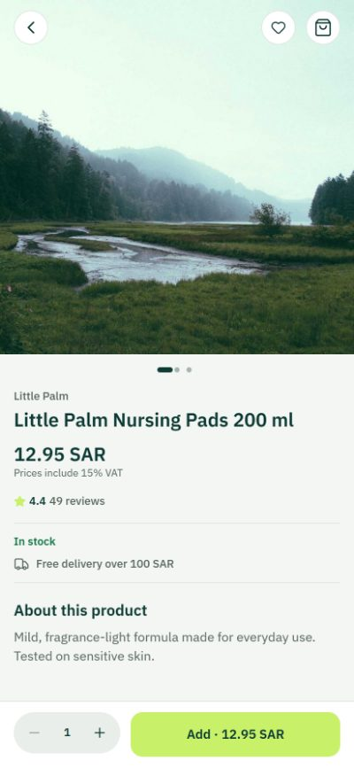
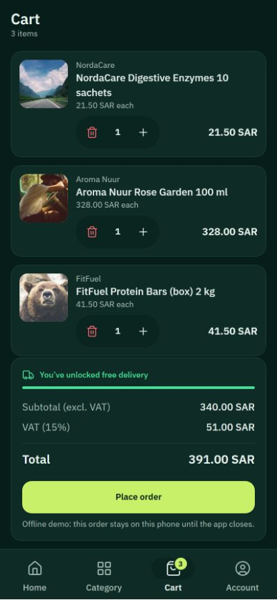

<p align="center">
  
</p>

<p align="center">
  <a href="https://github.com/ismailbentabett/nabd-pharmacy/actions/workflows/ci.yml"></a>
  <a href="LICENSE"></a>
  
  
  
  
</p>

<p align="center">
  <b>English</b> and <b>العربية</b> · motion on the UI thread · RTL down to the swipe direction
</p>

---

**Nabd** (نبض, "pulse") is a bilingual pharmacy shopping app for Algiers, built with React Native (Expo SDK 58).
It is built motion-first and performance-first: gestures and animations run on the UI thread, and Arabic flips the
whole app to RTL, including swipe and transition directions. Android is the target platform.

It works with no setup on a built-in fake backend (1,000 products from a fixed seed, pages of 20, 300-800 ms delay,
about 1 in 20 requests fail). Add Supabase keys and it uses a real backend with accounts, favourites sync and orders.
Prices are in Algerian dinars (DA in English, د.ج in Arabic) and include 19% TVA.

> The project started as a take-home brief for a pharmacy app and was then rebranded and extended into this
> standalone app (ADR-055). Some requirement IDs in the docs (H-01, C-03, F-01 and so on) come from that brief.

## Contents

- [Screenshots](#screenshots)
- [Features](#features)
- [Quick start](#quick-start)
- [Architecture](#architecture)
- [Main decisions](#main-decisions)
- [Testing](#testing)
- [Performance](#performance)
- [Where AI tools were used](#where-ai-tools-were-used)
- [Known limits and what comes next](#known-limits)
- [Contributing, security and license](#contributing)

## Screenshots

| | | |
|:---:|:---:|:---:|
|  |  |  |
| Home | Category (1,000-item grid) | Product |
|  |  |  |
| الرئيسية (Home, RTL) | المنتج (Product, RTL) | السلة (Cart, RTL) |
|  |  |  |
| Home, dark | Category, dark | Cart, dark |

## Features

- **Home**: search header that collapses into a compact bar on scroll, auto-playing banner carousel with a page
  indicator (pauses on touch), category rail, best-sellers rail. The search field opens the Search screen.
- **Category**: two-column virtualised grid of 1,000 products (FlashList v2), images fade in once from a colour
  placeholder, and a filter and sort bottom sheet that follows the finger and snaps open or closed.
- **Product**: shared-element transition (the tile image grows into the gallery and returns on back; back can be
  driven by a swipe), swipeable gallery with page indicator, add-to-cart feedback that bumps the cart badge, and
  the favourite heart.
- **Cart**: items animate in and out and the list closes the gap, swipe to delete with undo, quantity stepper,
  subtotal, 19% TVA line and total in DA, and a checkout button.
- **Account** (tab): email sign-in, favourites list and order history. Without Supabase keys it says so and the
  rest of the app keeps working.
- **Search** (pushed screen, `app/search.tsx`): see below.
- **Finish**: launch screen with the brand mark, skeletons for every loading state, designed empty and error
  states, reduce-motion variants, and dark mode that follows the system.

<details>
<summary><b>Backend, accounts, checkout, favourites, search</b></summary>

- **Optional Supabase backend.** `getSupabase()` in `src/core/supabase/client.ts` returns `null` when there are no
  keys, and the app falls back to the fake API. `api.kind` and `ordersApi.kind` say which one is live
  (`'fake'` or `'supabase'`). Only the anon key ships in the app; Row Level Security is the security boundary
  (ADR-056). The schema, RLS policies, `place_order` function and search are in `supabase/migrations/`.
- **Email one-time-code sign-in** (`src/features/account/auth.ts`). One session store
  (`src/state/session.store.ts`) with four states: `offline`, `loading`, `signedOut`, `signedIn` (ADR-056).
- **Checkout and order history** (`src/core/api/ordersApi.ts`, `src/state/orders.ts`,
  `src/features/cart/CheckoutButton.tsx`, `CheckoutSuccess.tsx`, `src/features/orders/OrdersSection.tsx`). With
  Supabase, the client sends only product ids and quantities to the `place_order` function, which prices the
  order on the server in integer centimes, TVA included. Without Supabase, orders are placed in memory on the
  device and the app says so (ADR-057). There are no real payments.
- **Favourites** (`src/state/favorites.store.ts`). One heart, shared by the grid tile and the product page. It is
  stored locally in MMKV and mirrored to `public.favorites` when signed in. Each tile subscribes to a per-id
  boolean, so toggling one heart re-renders only the hearts for that id. The heart has a pop animation and a
  reduce-motion variant (ADR-058).
- **Search** (`src/features/search/SearchScreen.tsx`). Typing is debounced (250 ms), results are cached, and
  every state has its own view: idle, loading, empty, error with retry, results. Result tiles are sources for
  the shared-element transition, same as the grid (ADR-059).

</details>

## Quick start

Needs **Node 22+**, a JDK and the Android SDK, and an Android phone with USB debugging on. Expo Go is not supported
(ADR-001): this is a native build. A fresh clone works with no keys, on the fake backend.

```bash
git clone https://github.com/ismailbentabett/nabd-pharmacy.git nabd && cd nabd   # 1
npm ci                                                                         # 2
bash scripts/perf/android-release-build.sh                                     # 3: builds the release APK and installs it on the USB phone
```

That is 3 commands. The first native build takes several minutes (8 min 23 s on one Windows PC, ADR-040).

- **Windows:** the native build needs a project path of 5 characters or fewer, for example
  `git clone https://github.com/ismailbentabett/nabd-pharmacy.git C:/nb`, then run the rest from `C:/nb`. The
  script checks this and prints the exact command if the path is too long (ADR-040).
- **Demo build:** add `--demo` to command 3 to keep the 1-in-20 fake failures visible. The default build turns
  them off so a 10 s fling never stops on an error row.
- **Build without a phone:** `PERF_NO_DEVICE=1 bash scripts/perf/android-release-build.sh` builds the APK and skips the install.
- **Dev build with hot reload:** `npm run android` (a debug build, then Metro). Debug builds are slower and are
  not used for any number below.
- **Web preview (layout only):** `npx expo start --web`. It is not the target platform.
- **Tests and type check:** `bash scripts/check.sh --quick` (typecheck, pattern linter and its self-test, Jest).
  `--full` adds expo lint, expo-doctor, brief coverage and a repo hygiene check.

<details>
<summary><b>Optional: use Supabase</b></summary>

1. Create a Supabase project.
2. Run the four files in `supabase/migrations/` in order (schema, RLS, `place_order`, search).
3. Load the catalog with `supabase/seed.sql`. To regenerate it from the same fixed seed, run
   `npm run supabase:seed` (`scripts/supabase/make-seed.ts`).
4. In a `.env` file at the repo root, set `EXPO_PUBLIC_SUPABASE_URL` and `EXPO_PUBLIC_SUPABASE_ANON_KEY` to the
   project URL and the anon (public) key. Never put the service-role key in the app.
5. Enable the email provider in Supabase Auth so one-time codes can be sent.

Expo inlines these variables at build time, so rebuild after changing them. Remove them and the app goes back to
the fake backend.

</details>

## Architecture

```
app/                  Expo Router: (tabs)/ index, category, cart, account; product/[id]; search
src/core/             Seeded catalog generator, image URL sizing, integer-centime money, seeded RNG
src/core/api/         Fake API, Supabase API, orders API (each behind one shared interface)
src/core/supabase/    Supabase client (null without keys)
src/state/            Cart, favourites, session and orders stores, cart maths (TVA split), query client, API wiring
src/motion/           Spring tokens, gesture maths, haptics, reduced-motion; hero/ = shared-element engine
src/ui/               Shared UI: tab bar, bottom sheet, badge, stepper, price block, image, skeleton, states
src/features/home     Header, carousel, rails
src/features/category Grid, tile, filter/sort sheet, paging hook
src/features/product  Gallery, add-to-cart bar and fly-to-cart motion, product body
src/features/cart     Swipe rows, list with layout animations, summary, checkout button and success view
src/features/account  Account screen, sign-in form, auth (email code), favourites list
src/features/orders   Order history section
src/features/search   Search screen
src/i18n/             Typed EN/AR dictionary, plurals, number formatting, direction (the only place that reads I18nManager)
src/design/           Palette, tokens, type scale, fonts, Text, PressableScale, brand mark
supabase/             migrations/ (schema, RLS, place_order, search) and the generated seed.sql
tests/                Jest + React Native Testing Library
scripts/              check.sh, pattern linter, perf/ (build, cold start, gfxinfo, memory, Flashlight)
scripts/supabase/     Seed generator (npm run supabase:seed)
scripts/brand/        Icon generation from the brand mark
docs/                 ADRs, plan, specs, requirements trace, perf log, AI disclosure, README images
.claude/              Subagents, skills and commands used to build this (see "Where AI tools were used")
```

Stack: Expo SDK 58 (React Native 0.88, New Architecture, Hermes, React Compiler) · Expo Router · TypeScript strict ·
Reanimated 4 + `react-native-worklets` · Gesture Handler 3 (hooks API) · FlashList v2 · `expo-image` · zustand ·
TanStack Query · `react-native-mmkv` · IBM Plex Sans and IBM Plex Sans Arabic · optional Supabase.

## Main decisions

Full list with reasons: [`docs/DECISIONS.md`](docs/DECISIONS.md). Requirement-to-code map: [`docs/REQUIREMENTS_TRACE.md`](docs/REQUIREMENTS_TRACE.md).

Newer decisions:

- ADR-055: rebrand to Nabd (pine `#0E3B35` and lime `#C8F169`, a lime disc with a pine pulse line).
- ADR-056: accounts are optional, by email one-time code, with one session store.
- ADR-057: checkout goes through a server-priced `place_order` function; offline orders stay on the device.
- ADR-058: favourites ship as one local-first store, mirrored when signed in (supersedes ADR-014).
- ADR-059: search is one ranking, implemented twice (fake API and Supabase).

<details>
<summary><b>Core decisions from the first build</b></summary>

- Shared-element transition is a custom measured-rectangle overlay driven by one shared progress value, so a
  swipe can drive it and a touch can interrupt it (ADR-004), with its own spring tuned to settle under 320 ms (ADR-030).
- RTL uses the native layout flip plus an app reload, so Yoga, FlashList order, text alignment and system back all
  mirror together (ADR-005). The language is derived from the native direction, never stored separately (ADR-031).
- The cart is kept in MMKV and read before first render, so it survives the language restart (ADR-031, ADR-003).
- Money is integer centimes everywhere (1 DA = 100 centimes); floats appear only when formatting
  (`docs/CART_SPEC.md`, `src/core/money.ts`). Prices include TVA, so the TVA line is
  `tva = floor((38 * gross + 119) / 238)` (19/119 of the gross, rounded half up, once) and `net = gross - tva`.
- The grid and rails use FlashList v2; grid images are requested at a bucketed display size, not 800 px (ADR-007, ADR-008).
- The cart is a plain ScrollView, because layout animations are only safe in non-recycled lists (ADR-007).
- Gestures use the Gesture Handler 3 hooks API; animation runs on the UI thread with Reanimated shared values and
  worklets, with no per-frame React state (ADR-001, ADR-036).
- A pattern linter fails the build on `runOnJS`, state setters in worklets, layout props in animated styles,
  physical left/right, raw hex and similar (ADR-036).
- Cart swipe rows share one `openRowId` shared value, so only one row is open and no row re-renders (ADR-041).
- Product back is finger-driven two ways, both scrubbing the same hero progress as the Back button: a horizontal
  swipe on the page body and a pull-down on the gallery while the page is at the top. Android Back runs the same
  close (ADR-046).
- The hero also animates `borderRadius`, an exception to "transform and opacity only", so the image does not show
  sharp corners leaving a rounded tile. Its GPU cost is **NOT MEASURED YET**; the transition trace decides whether
  it stays (ADR-047).
- Release builds for measurement turn the fake API's failures off by build-time switch; `--demo` turns them on (ADR-040).
- Dark mode follows the system by re-mapping the same tokens (ADR-053).

</details>

## Testing

```bash
npm test                          # Jest only
bash scripts/check.sh --quick     # typecheck, pattern linter and its self-test, Jest
```

The suite has **839 Jest tests in 56 suites**. Jest covers:

- Cart quantities, totals and the 19% TVA split against the vectors in `docs/fixtures/cart-vectors.json`, plus the store and undo.
- Catalog determinism (same seed, same 1,000 products) and the fake API (paging, delay, failures).
- i18n: EN/AR key and placeholder parity, plurals, number formatting.
- Gesture and motion maths: sheet snapping, hero geometry, swipe, carousel, header, fly path, spring settle times.
- Screen and component tests for the screens, tab bar and badge.

CI ([`.github/workflows/ci.yml`](.github/workflows/ci.yml), Node 22) runs the typecheck, lint and Jest on every
push and pull request to `master`.

Jest runs against the fake backend only. Nothing in the test suite talks to a real Supabase project, so the
migrations, RLS policies and `place_order` have not been tested end to end in CI. Jest also cannot cover things
like one swipe row closing another, because Reanimated's mock never runs `useAnimatedReaction`; those are on the
device checklist.

## Performance

**Nothing has been measured on a phone yet.** Every cell below is copied from [`docs/PERF_LOG.md`](docs/PERF_LOG.md),
which holds the raw evidence paths once runs exist. Honest misses will be written down as misses. The newer
features (Account, Search, checkout, favourites, Supabase data) have not been measured on a device either.

| Field | Value |
|---|---|
| Device model | NOT MEASURED YET |
| Android version / build | NOT MEASURED YET |
| Build type | NOT MEASURED YET (planned: release APK from `scripts/perf/android-release-build.sh`) |

| ID | Metric | Target | Result |
|---|---|---|---|
| F-01 | Janky frames, 10 s grid fling (warm cache) | < 1 % | NOT MEASURED YET |
| F-01 | Same, cold (unwarmed) | report | NOT MEASURED YET |
| F-01 | Avg UI FPS (Flashlight) | >= 58 at 60 Hz | NOT MEASURED YET |
| F-04 | Hero transition janky frames / duration | 0 janky, <= 350 ms | NOT MEASURED YET |
| F-07 | Cold start TotalTime (median of 10) | < 2000 ms | NOT MEASURED YET |
| F-07 | Time to first product visible | report | NOT MEASURED YET |
| F-08 | PSS after pass 1 to pass 2 | flat (+-8 %) | NOT MEASURED YET |
| F-03 | Touch feedback latency | <= 100 ms | NOT MEASURED YET |
| F-05 | Tile re-renders on add-to-cart | 0 | NOT MEASURED YET |

How they will be measured: a release build on a real mid-range Android phone, using `scripts/perf/cold-start.sh`,
`gfxinfo-fling.sh`, `transition-gfxinfo.sh`, `memory-scroll.sh` and `flashlight.sh`. Protocol: `docs/PERF_PLAN.md`.
Raw output goes to `docs/evidence/raw/`. Simulators, emulators and debug builds are not used for any figure.

## Where AI tools were used

Claude Code wrote nearly all of the code, tests and docs, working from my brief, my hard rules in `CLAUDE.md` and
the ADRs. That covers the core data and cart logic, the design system, the motion layer and hero engine, the
original four screens, the linter and the perf scripts. The rebrand, the Supabase layer, the Account tab,
checkout and orders, favourites and search were also built with Claude Code (agents) and reviewed by me. Separate
AI reviewer passes ran after features, and a `ui-designer` agent reviewed screens against `docs/DESIGN.md`. Library
APIs were checked against the installed versions before use. The README banner and social preview were also
rendered with AI help from the real screenshots. I set the direction, stack and rules, and kept the scope small.
I have not tuned anything on a device yet. [`docs/AI_DISCLOSURE.md`](docs/AI_DISCLOSURE.md) is the full account,
including open items. Subagents, skills and commands are committed in `.claude/`.

## Known limits

- No device measurements yet (see [Performance](#performance)).
- Payments are out of scope: checkout places an order, it does not charge anyone.
- The Supabase path is not covered by automated tests that hit a real project.
- The Expo web preview shows layout only and says nothing about motion or performance.

### What we would do next

- Run the device measurements, including the new screens, fix what they show, and fill `docs/PERF_LOG.md`, with honest misses.
- Add a Baseline Profile for cold start, then tune the spring tokens on the phone (ADR-006).
- Order detail screen and push notifications for order status.
- Password-less sign-in by deep link, instead of typing a code.
- Real payments, behind the same `place_order` seam.
- An in-app light/dark override (today the app follows the system).
- TalkBack audit and font-scale 1.3x check on device.
- Maestro flows in CI (flows are in `scripts/perf/flows/`).

## Contributing

Contributions are welcome. Read [CONTRIBUTING.md](CONTRIBUTING.md) first and follow the
[Code of Conduct](CODE_OF_CONDUCT.md). Report security issues privately as described in [SECURITY.md](SECURITY.md),
not in a public issue.

## License

[MIT](LICENSE)
